# WLAN BLE Power Save

## 1. Purpose / Scope

The example demonstrates how to configure the device in WiSeConnect coex mode with WLAN standby and BLE-connected power save running in the RS9116W EVK module.
In this coex application, a Silicon Labs BLE device connects with a remote BLE device (for example, a smartphone with an spp pro application) and issues a connected power save command to module.

The application uses both BLE and WLAN tasks to enable communication between a smartphone and a remote PC. Messages from the smartphone are received via BLE and forwarded through WLAN to the PC via an Access Point. Similarly, messages from the PC are sent via WLAN to BLE, enabling seamless bidirectional data transfer.

### 1.1 WLAN Task

This application explains how to:

- Create a Silicon Labs device as a station.
- Connect a Silicon Labs station to remote access point and get an IP.
- Enable the appropriate power save mode and then wait in a scheduler for some time.
- Receive TCP data sent by the connected station and forward it to the BLE task.
- Send data received by the BLE task to the connected station using TCP over SSL client protocol.

### 1.2 BLE Task

This application explains how to:

- Configure the device in advertise mode.
- Connect from a smartphone/dongle.
- Configure a device in power save profile mode 2.
- Receive data from the WLAN task and send it to the connected remote BLE device via GATT.
- Send data received from the remote BLE device via GATT to the WLAN task.


## 2. Prerequisites / Setup Requirements

The WiSeConnect parts require that the host processor is connected to the WiSeConnect using an SPI, UART, or USB host interface. The host processor firmware needs to properly initialize the selected host interface. The Silicon Labs Wireless SAPI framework provides necessary HAL APIs to enable a variety of host processors.

Before running the application, the user will need the following things to setup.

### 2.1 Hardware Requirements

- Windows / Linux PC with Host interface (UART/ USB-CDC/ SPI/ USB) in case of WiSeConnect.
- Silicon Labs [RS9116 Wi-Fi Evaluation Kit](https://www.silabs.com/development-tools/wireless/wi-fi/rs9116x-sb-evk-development-kit)
- Host MCU Eval Kit. This example has been tested with:
   - Silicon Labs [WSTK + EFR32MG21](https://www.silabs.com/development-tools/wireless/efr32xg21-bluetooth-starter-kit)
   - [STM32F411 Nucleo](https://st.com/)
- Wireless Access point.
- Windows PC2 with SSL server application (openssl).
- BLE supported smart phone with GATT client application.

<br>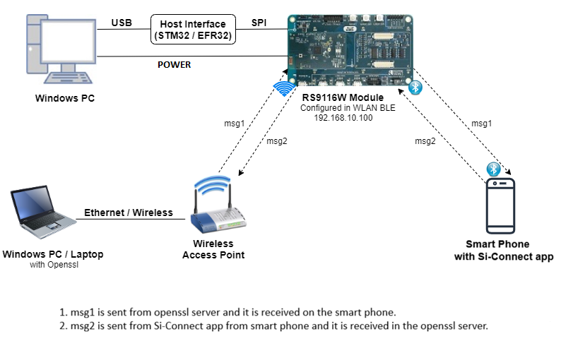<br>


### 2.2 Software Requirements

- [RS9116 SDK](https://github.com/SiliconLabs/wiseconnect-wifi-bt-sdk/)
    
- Embedded Development Environment

   - For STM32, use licensed [Keil IDE](https://www.keil.com/demo/eval/arm.htm)

   - For Silicon Labs EFx32, use the latest version of [Simplicity Studio](https://www.silabs.com/developers/simplicity-studio)
   
- Download and install OpenSSL from this link [OpenSSL](http://ufpr.dl.sourceforge.net/project/gnuwin32/openssl/0.9.8h-1/openssl-0.9.8h-1-bin.zip) to download openssl in remote PC.

- Download and install the Silicon Labs [Simplicity Connect Mobile App](https://www.silabs.com/software-and-tools/simplicity-connect-mobile-app) in the Android smart phones for testing BLE applications. Users can also use their choice of BLE apps available in Android/iOS smart phones.


### 3. Application Build Environment

### 3.1 Platform

The Application can be built and executed on below Host platforms
* [STM32F411 Nucleo](https://st.com/)
* [WSTK + EFR32MG21](https://www.silabs.com/development-tools/wireless/efr32xg21-bluetooth-starter-kit) 

### 3.2 Host Interface

* By default, the application is configured to use the SPI bus for interfacing between Host platforms and the RS9116W EVK.
* The SAPI driver provides APIs to enable other host interfaces if SPI is not suitable for your needs.

### 3.3 Project Configuration

The Application is provided with the project folder containing Keil and Simplicity Studio project files.

* Keil Project
  - The Keil project is used to evaluate the application on STM32.
  - Project path: `<SDK>/examples/snippets/wlan_ble/wlan_ble_power_save/projects/wlan_ble_power_save-nucleo-f411re.uvprojx`

* Simplicity Studio
  - The Simplicity Studio project is used to evaluate the application on EFR32MG21.
  - Project path: 
    - If the Radio Board is **BRD4180A** or **BRD4181A**, then access the path `<SDK>/examples/snippets/wlan_ble/wlan_ble_power_save/projects/wlan_ble_power_save-brd4180a-mg21.slsproj`
    - If the Radio Board is **BRD4180B** or **BRD4181B**, then access the path `<SDK>/examples/snippets/wlan_ble/wlan_ble_power_save/projects/wlan_ble_power_save-brd4180b-mg21.slsproj`
    - User can find the Radio Board version as given below 

<br>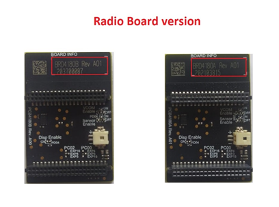<br>


### Bare Metal Support

This application supports only bare metal environment. By default, the application project files (Keil and Simplicity Studio) are provided with bare metal configuration. 


## 4. Application Configuration Parameters

The application can be configured to suit your requirements and development environment. Read through the following sections and make any changes needed.

### 4.1 Configuring the WLAN task

**4.1.1** Open the `rsi_wlan_app.c` file and modify the following macros:

SSID refers to the name of the Access point.

```c
#define SSID                                          "REDPINE_AP"
```

CHANNEL_NO refers to the channel in which device should scan. If it is 0, device will scan all channels.

```c
#define CHANNEL_NO                                     0
```

SECURITY_TYPE refers to the type of security. In this application STA supports Open, WPA-PSK, WPA2-PSK securities.

   Valid configuration is: 

   - RSI_OPEN - For OPEN security mode
   - RSI_WPA  - For WPA security mode 
   - RSI_WPA2 - For WPA2 security mode

```c
#define SECURITY_TYPE                                 RSI_OPEN
```

PSK refers to the secret key if the access point is configured in WPA-PSK/WPA2-PSK security modes.

```c
#define PSK                                           "<psk>"
```

To Load certificate:

```c
#define LOAD_CERTIFICATE                              1
```

   If **LOAD_CERTIFICATE** set to 1, application will load certificate which is included using rsi_wlan_set_certificate API.
   
   By default, the application loads "cacert.pem" certificate if **LOAD_CERTIFICATE** is enable. In order to load different certificate, user has to follow the following steps:
   
rsi_wlan_set_certificate API expects the certificate in the form of linear array. So, convert the pem certificate into linear array form using python script provided in the release package "certificate_script.py".

  Example: If the certificate is `wifi-user.pem`, give the command in the following way:

```sh
python certificate_to_array.py <input_file> <output_file>
Example: python certificate_to_array.py wifi-user.pem wifiuser.pem
```
  The script will generate `wifiuser.pem` in which one linear array named `wifiuser[]` contains the certificate.

After converting the certificate, update the `rsi_wlan_app.c` source file by including the certificate file and by providing the required parameters to the `rsi_wlan_set_certificate` API.

> Note: 
> Once the certificate loads into the device, it will write into the device flash. So, the user does not need the load certificate for every boot up unless the certificate changes.

Define LOAD_CERTIFICATE as 0 if the certificate is already present in the Device.

> Note:
> All the certificates are given in the release package `<SDK>/resources/certificates`

DEVICE_PORT port refers to SSL client port number.

```c
#define DEVICE_PORT                                  5001
```

SERVER_PORT port refers to remote the SSL server port number.

```c
#define SERVER_PORT                                  5001
```

SERVER_IP_ADDRESS refers to the remote peer IP address to connect with SSL server socket.
```c
#define SERVER_IP_ADDRESS                           "192.168.10.100"
```

To configure IP address

Enable / Disable: DHCP mode 1-Enables DHCP mode (gets the IP from DHCP server), 0-Disables DHCP mode
```c
#define DHCP_MODE                             1
```

If user wants to configure module IP address through STATIC IP, then configure the DEVICE_IP, GATEWAY and NETMASK macros as below.
```c
#define   DEVICE_IP                           "192.168.10.101"
#define   GATEWAY                             "192.168.10.1"
#define   NETMASK                             "255.255.255.0" 
```

**4.1.2** In the **rsi_ble_app.c** file, default power save mode configuration is set to low power mode 2 (RSI_SLEEP_MODE_2) with maximum power save (RSI_MAX_PSP) with a message-based hand shake.

```c
#define PSP_MODE  RSI_SLEEP_MODE_2
#define PSP_TYPE  RSI_MAX_PSP
```

**4.1.3** Open the `rsi_wlan_config.h` file and modify following macros:

```c
#define CONCURRENT_MODE                              RSI_DISABLE
#define RSI_FEATURE_BIT_MAP                          (FEAT_SECURITY_OPEN | FEAT_AGGREGATION | FEAT_ULP_GPIO_BASED_HANDSHAKE | FEAT_DEV_TO_HOST_ULP_GPIO_1)
#define RSI_TCP_IP_BYPASS                            RSI_DISABLE
#define RSI_TCP_IP_FEATURE_BIT_MAP                   (TCP_IP_FEAT_DHCPV4_CLIENT | TCP_IP_FEAT_SSL | TCP_IP_FEAT_EXTENSION_VALID)
#define RSI_CUSTOM_FEATURE_BIT_MAP                   (FEAT_CUSTOM_FEAT_EXTENTION_VALID | CUSTOM_FEAT_SOC_CLK_CONFIG_120MHZ)
#define RSI_EXT_CUSTOM_FEATURE_BIT_MAP               (EXT_FEAT_LOW_POWER_MODE | EXT_FEAT_XTAL_CLK_ENABLE | EXT_FEAT_384K_MODE)
#define RSI_EXT_TCPIP_FEATURE_BITMAP                 EXT_TCP_IP_WINDOW_DIV
#define RSI_BAND                                     RSI_BAND_2P4GHZ
```

Default configuration of low power save mode 2:

```c
#define RSI_HAND_SHAKE_TYPE GPIO_BASED
#define RSI_SELECT_LP_OR_ULP_MODE RSI_ULP_WITH_RAM_RET
#define RSI_DTIM_ALIGNED_TYPE 0
#define RSI_MONITOR_INTERVAL 50
#define RSI_WMM_PS_ENABLE RSI_DISABLE
#define RSI_WMM_PS_TYPE 0 
#define RSI_WMM_PS_WAKE_INTERVAL 20
#define RSI_WMM_PS_UAPSD_BITMAP 15
```

## 4.2 Configuring the BLE task

**4.2.1** Open the `rsi_ble_app.c` file and modify following macros:

RSI_BLE_NEW_SERVICE_UUID refers to the newly created custom service.

```c
#define RSI_BLE_NEW_SERVICE_UUID                     0xAABB
```

RSI_BLE_ATTRIBUTE_1_UUID refers to the first characteristic under this custom service (RSI_BLE_NEW_SERVICE_UUID).

```c
#define RSI_BLE_ATTRIBUTE_1_UUID                      0x1AA1
```

RSI_BLE_ATTRIBUTE_2_UUID refers to the second characteristic under this custom service (RSI_BLE_NEW_SERVICE_UUID).

```c
#define RSI_BLE_ATTRIBUTE_2_UUID                      0x1BB1
```

RSI_BLE_MAX_DATA_LEN refers to the maximum length of the attribute data.

```c
#define RSI_BLE_MAX_DATA_LEN                         20
```

RSI_BLE_APP_DEVICE_NAME refers to the name of the Silicon Labs device to appear during scanning by remote devices.

```c
#define RSI_BLE_APP_DEVICE_NAME                       "WLAN_BLE_SIMPLE_CHAT"
```

Following are the **non-configurable** macros in the application:

RSI_BLE_CHAR_SERV_UUID refers to the client characteristic declaration.

```c
#define RSI_BLE_CHAR_SERV_UUID                         0x2803
```

RSI_BLE_CLIENT_CHAR_UUID refers to the client characteristic configuration descriptor.

```c
#define RSI_BLE_CLIENT_CHAR_UUID                       0x2902
```

RSI_BLE_ATT_PROPERTY_READ is used to set the READ property to an attribute value.

```c
#define RSI_BLE_ATT_PROPERTY_READ                       0x02
```

RSI_BLE_ATT_PROPERTY_WRITE is used to set the WRITE property to an attribute value.

```c
#define RSI_BLE_ATT_PROPERTY_WRITE                    0x08
```

RSI_BLE_ATT_PROPERTY_NOTIFY is used to set the NOTIFY property to an attribute value.

```c
#define RSI_BLE_ATT_PROPERTY_NOTIFY                   0x10
```

**4.2.2** Open `rsi_ble_config.h` file. User can also modify the below parameters as per their needs and requirements. 

```c
#define RSI_BLE_PWR_INX                               30
#define RSI_BLE_PWR_SAVE_OPTIONS                      0
```


## 5. Testing the Application

Follow the below steps for the successful execution of the application.

### 5.1 Loading the RS9116W Firmware

Refer [Getting started with PC ](https://docs.silabs.com/rs9116/latest/wiseconnect-getting-started) to load the firmware into RS9116W EVK. The firmware binary is located in `<SDK>/firmware/`

### 5.2 Building the Application on the Host Platform

#### 5.2.1 Using STM32

Refer [STM32 Getting Started](https://docs.silabs.com/rs9116-wiseconnect/latest/wifibt-wc-getting-started-with-efx32/)  

- Open the project `<SDK>/examples/snippets/wlan_ble/wlan_ble_power_save/projects/wlan_ble_power_save-f411re.uvprojx` in Keil IDE.
- Build and Debug the project
- Check for the RESET pin:
  - If RESET pin is connected from STM32 to RS9116W EVK, then user need not press the RESET button on RS9116W EVK before free run.
  - If RESET pin is not connected from STM32 to RS9116W EVK, then user need to press the RESET button on RS9116W EVK before free run.
- Free run the project
- Then continue the common steps from **Section 5.3**

### 5.2.2 Using EFX32

Refer [EFx32 Getting Started](https://docs.silabs.com/rs9116-wiseconnect/latest/wifibt-wc-getting-started-with-efx32/)

- Import the project from `<SDK>/examples/snippets/wlan_ble/wlan_ble_power_save/projects`
- Select the appropriate .slsproj as per Radio Board type mentioned in **Section 3.3**
- Compile and flash the project in to Host MCU
- Debug the project
- Check for the RESET pin:
  - If RESET pin is connected from EFX32 to RS9116W EVK, then user need not press the RESET button on RS9116W EVK before free run
  - If RESET pin is not connected from EFX32 to RS9116W EVK, then user need to press the RESET button on RS9116W EVK before free run
- Free run the project
- Then continue the common steps from **Section 5.3**

### 5.3 Common Steps

1. Configure the access point in OPEN/WPA-PSK/WPA2-PSK mode to connect Silicon Labs device in STA mode.

2. In Windows PC2 which is connected to AP through LAN. Download the Openssl package from above mentioned link and run SSL server by giving following command:

```sh
Openssl.exe s_server -accept <SERVER_PORT> –cert <server_certificate_file_path> -key <server_key_file_path> -tls<tls_version>
Example: openssl.exe s_server –accept 5001 –cert server-cert.pem -key server-key.pem –tls1
```

<br>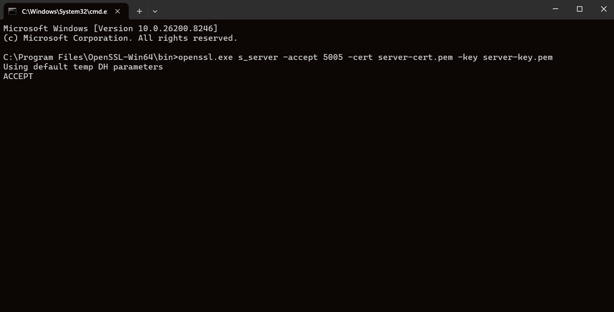<br>

3. After the program gets executed, Silicon Labs BLE is in Advertising state and WLAN connects to the Access Point and establishes SSL connectivity with SSL server opened on Windows PC2. The following image illustrates the connection establishment at Windows PC2.

<br>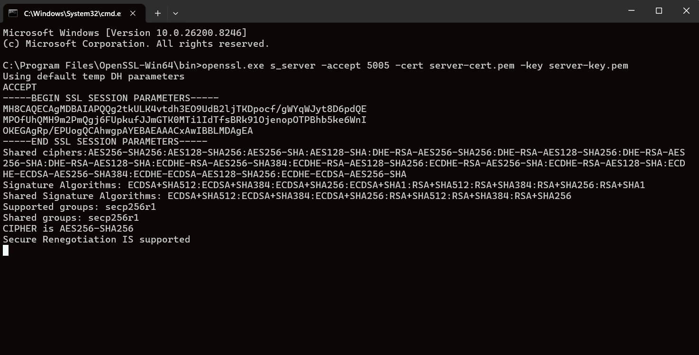<br>

4. Open Simplicity Connect app in the smartphone and perform the Scan.

5. In the App, the Silicon Labs module device will appear with the name configured in the macro **RSI_BLE_APP_DEVICE_NAME (Ex: "WLAN_BLE_APP")** or sometimes observed as a RS9116W EVK as internal name "**SimpleBLEPeripheral**".

<br>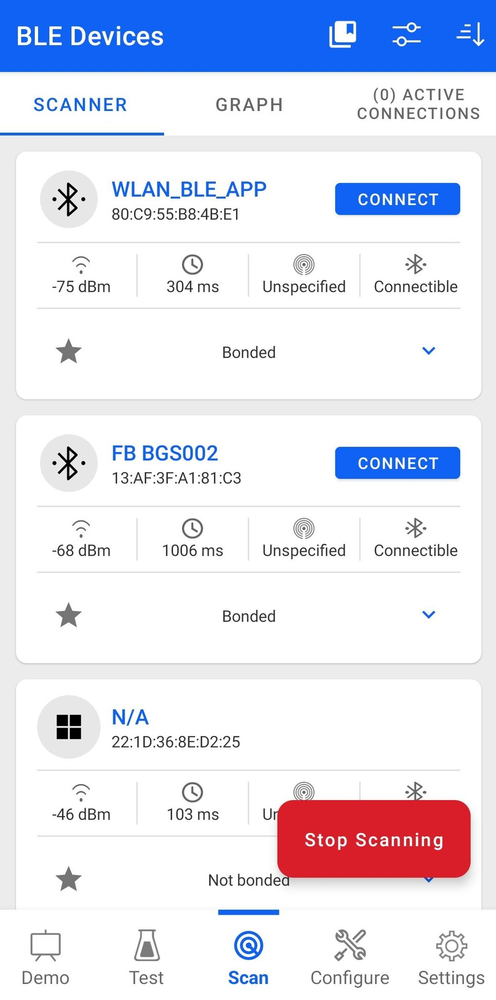<br>

6. Initiate the BLE connection from the app.

<br>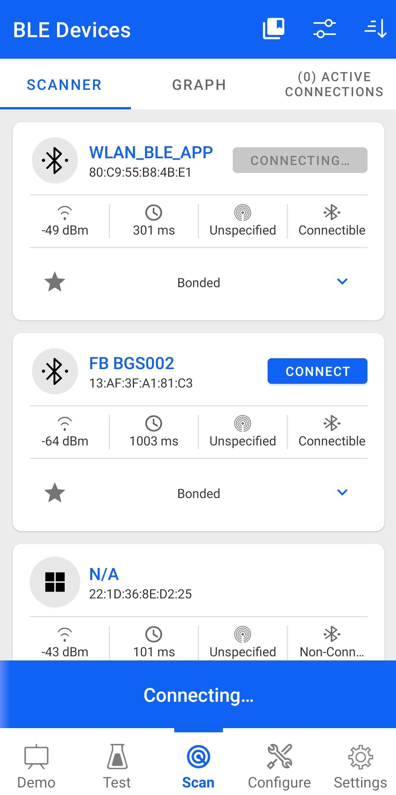<br>

7. Once the connection is established, the SiConnect app displays all services supported by the Silicon Labs module.

8. After the BLE connection is set up, the device enters the configured coex power-save mode.

9. Select the custom service which is added **RSI_BLE_NEW_SERVICE_UUID** (for example, `0xAABB`) and enable Notification for attribute UUID **RSI_BLE_ATTRIBUTE_2_UUID** (for example, `0x1BB1`) to receive data sent by Wi-Fi STA.

<br>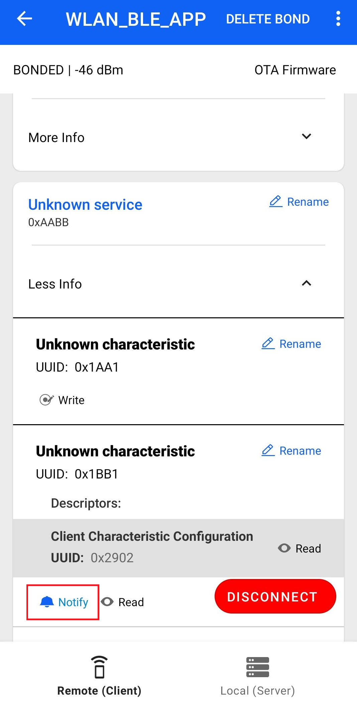<br>

10. From SSL server (Windows PC2), send a message (for example, **Hello from WiFi STA**) to the Silicon Labs device. The Silicon Labs device forwards the received message from SSL server to remote BLE device which is connected to Silicon Labs BLE device over BLE protocol. User can observe the message notification on attribute UUID **RSI_BLE_ATTRIBUTE_2_UUID** (for example, **0x1BB1**) in the SiConnect app.

<br>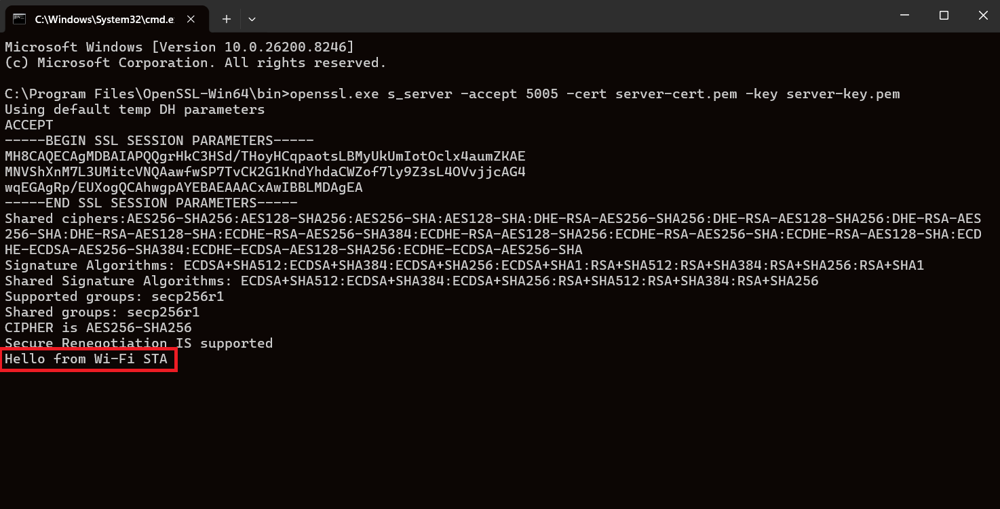<br>

<br>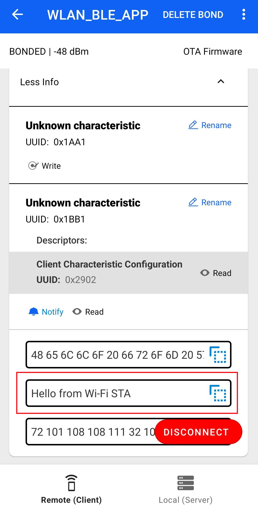<br>

> Note: 
> The `rsi_wlan_app_send_to_ble()` function defined in `rsi_ble_app.c` sends a message from the WLAN task to BLE task.

11. Now send a message (for example, **Hello from BLE**) from GATT client (from the smartphone SiConnect app) using attribute **RSI_BLE_ATTRIBUTE_1_UUID** (for example, `0x1AA1`) to Silicon Labs device. Silicon Labs device forwards the received message from BLE remote device to SSL server over WiFi protocol. The user can observe the message on SSL socket application.

<br>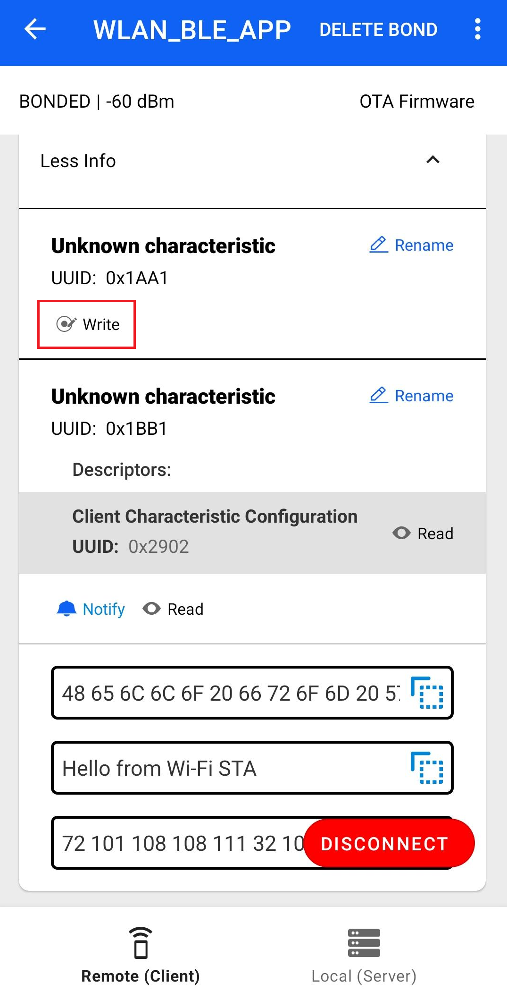<br>

<br>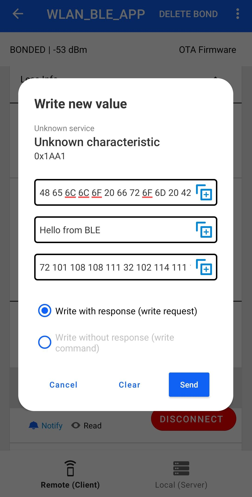<br>

<br>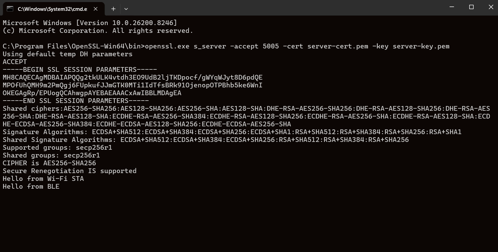<br>

> Note:
> `rsi_bt_app_send_to_wlan()` function is defined in `rsi_wlan_app.c` to send message from BLE task to WLAN task.

12. Note down the power measurement by connecting Module to Agilent Power meter setup.


## Compressed Debug Logging

To enable the compressed debug logging feature please refer to [Logging User Guide](https://docs.silabs.com/rs9116-wiseconnect/latest/wifibt-wc-sapi-reference/logging-user-guide)